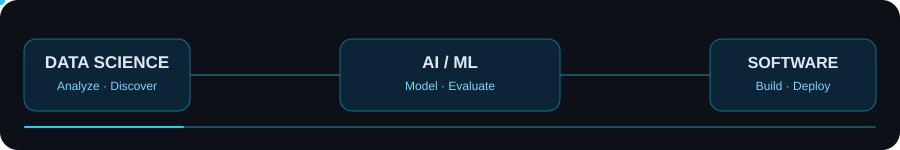
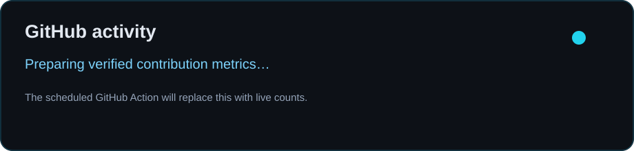

**Computer Engineering @ UEA · Research @ Laboratório Mais Acesso**

**Data Science · Machine Learning · AI Engineering · Full-Stack Development**

---

## About me

I'm **João Azevedo**, a Computer Engineering undergraduate at the **Universidade do Estado do Amazonas (UEA)** in Brazil. I work as a **research scholarship holder at Laboratório Mais Acesso**, contributing to technology and accessibility initiatives.

My interests span **data science, statistical analysis, machine learning, AI engineering, and software development**. I build web applications, backend services, AI-assisted tools, and developer-focused products. My priorities are **clean architecture, maintainability, performance, accessibility, and practical impact**.

- **Currently exploring:** data analysis, machine learning, AI engineering, developer tools, and production-ready software
- **Experience:** Research and assistive technology, web platform development, and technical mentoring
- **Open to:** Data science, machine learning and software engineering internships, research collaborations, and open-source contributions

## Tech stack

**Programming & data**

**Web engineering**

**Databases, infrastructure & tooling**

## Data science & AI

I am interested in the full data-to-product lifecycle: **data preparation → exploratory analysis → statistical reasoning → modeling → evaluation → deployment**. My software engineering work complements this focus through APIs, automation, and reproducible workflows.

**Areas of interest:** Python for data analysis · SQL · Statistics · Machine learning · Data visualization · AI-powered applications

> My portfolio includes software and AI projects; I distinguish ongoing data science learning from completed, production-validated ML work.

## Featured projects

| Project | What it demonstrates | Focus |
| :--- | :--- | :--- |
| **[AgentMetrics AI](https://github.com/mrJoao28/AgentMetrics-AI)** | AI-focused engineering project, development workflows and CI | AI · Engineering |
| **[My-Code-Agent](https://github.com/mrJoao28/My-Code-Agent)** | TypeScript coding agent and developer tooling | TypeScript · Agents |
| **[Computer Lab](https://github.com/mrJoao28/Computer-Lab)** | Interactive environment for exploring computer systems | Web · Education |
| **[FGO vs FGE](https://github.com/mrJoao28/fgo-vs-fge)** | Mathematical modeling and combinatorial exploration | Applied Math · Analysis |
| **[Financial](https://github.com/mrJoao28/financial)** | Financial application and data visualization | Full Stack · Data |
| **[CRUD Spring Java](https://github.com/mrJoao28/CRUD-Spring-JAVA)** | Java backend and CRUD application development | Java · Spring |

> Each repository is a work in progress or a learning milestone. Visit its README, source code, and commit history for implementation details and current status.

## Experience & education

**Research Scholarship Holder — Laboratório Mais Acesso**  
*Universidade do Estado do Amazonas*

Working on technology and accessibility initiatives, with experience in web platform maintenance, assistive technologies, and technical guidance.

**B.Sc. in Computer Engineering — UEA**  
*Undergraduate · Manaus, Brazil*

Building a foundation in computing, programming, mathematical modeling, and engineering.

## How I work

- **People first:** accessible, usable interfaces and inclusive technology
- **Data-driven:** explore, measure, validate, and communicate findings
- **Engineering quality:** readable architecture, tests, reviews, and CI
- **Continuous learning:** research, experimentation, and open-source projects

## GitHub activity

**[Explore my GitHub contributions](https://github.com/mrJoao28?tab=overview)** · **[View public repositories](https://github.com/mrJoao28?tab=repositories)**

The dashboard is generated from GitHub's API using a scheduled GitHub Action. Counts represent the rolling 12-month contribution window, not lifetime totals; GitHub's counting rules can omit some private or non-default-branch activity. If the workflow has not run yet, a placeholder is displayed instead of invented figures.

## Connect

I'm interested in **data science and machine learning internships**, **software engineering**, **AI engineering**, and building technology with meaningful impact.

**[Explore my repositories](https://github.com/mrJoao28?tab=repositories)** · **[Follow on GitHub](https://github.com/mrJoao28)**

Designed for clarity, accessibility, and fast scanning by recruiters.

